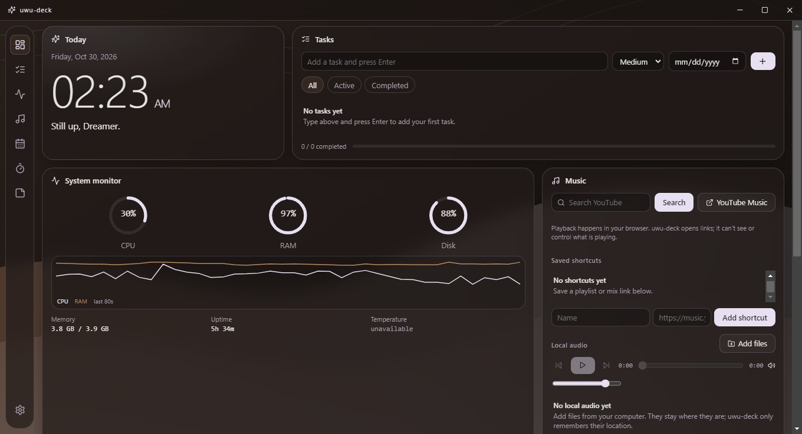
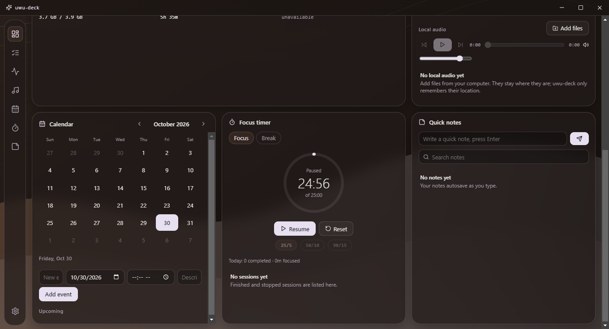

# uwu-deck

<p align="center">
  <strong>A modular desktop productivity dashboard for Windows.</strong>
  <br />
  Tasks, notes, focus sessions, calendar events, system metrics, and music — in one customizable workspace.
</p>

<p align="center">
  
  
</p>

<p align="center">
  
  
  
  
  
</p>

---

## Overview

**uwu-deck** is a Windows desktop productivity dashboard built with Electron, React, and TypeScript. It brings frequently used personal tools into one desktop application, reducing the need to switch between separate utilities for task management, note-taking, time tracking, and system monitoring.

The project combines a modular widget interface with local data persistence and native desktop integration. It is designed to work without user accounts or a cloud backend, keeping application data on the local machine.

Rather than building a collection of disconnected tools, uwu-deck focuses on making everyday workflows accessible through one consistent interface.

### Design principles

- **Local-first:** Personal application data is stored on the user's machine.
- **Modular:** Widgets can be shown, hidden, and reordered through Settings.
- **Desktop-native:** Tray behavior, keyboard shortcuts, window management, and launch-at-login settings integrate the dashboard into the Windows workflow.
- **Security-conscious:** The renderer uses a restricted preload bridge instead of unrestricted Node.js access.
- **Practical:** Features are designed around everyday tasks, not just visual presentation.

## Features

<table>
  <tr>
    <td width="50%" valign="top">
      <h3>✓ Task management</h3>
      Create, edit, complete, and delete tasks. Set priorities and due dates, filter tasks, track progress, and identify overdue items.
    </td>
    <td width="50%" valign="top">
      <h3>✎ Quick notes</h3>
      Create and edit notes inline, search content, pin important notes, and automatically save changes with debounced autosaving.
    </td>
  </tr>
  <tr>
    <td width="50%" valign="top">
      <h3>â—· Focus timer</h3>
      Start, pause, resume, and reset focus sessions. Use focus/break presets, review daily totals and session history, and receive desktop notifications with an in-app fallback.
    </td>
    <td width="50%" valign="top">
      <h3>â–¦ Calendar</h3>
      Navigate a monthly calendar, highlight today and the selected date, manage events, and view upcoming items.
    </td>
  </tr>
  <tr>
    <td width="50%" valign="top">
      <h3>⌁ System monitor</h3>
      Display real CPU, memory, disk, and uptime information using `systeminformation`. Unavailable metrics are identified instead of being replaced with fabricated values.
    </td>
    <td width="50%" valign="top">
      <h3>♫ Music</h3>
      Search YouTube and YouTube Music in the default browser, manage validated music shortcuts, and play local audio files using a built-in player.
    </td>
  </tr>
  <tr>
    <td width="50%" valign="top">
      <h3>â–£ Desktop integration</h3>
      Custom title bar, system tray, hide-to-tray behavior, `Ctrl+Alt+D` show/hide shortcut, remembered window geometry, single-instance behavior, and optional always-on-top mode.
    </td>
    <td width="50%" valign="top">
      <h3>âš™ Personalization</h3>
      Configure launch at login, tray behavior, reduced motion, timer defaults, monitoring intervals, and widget visibility and order. Export or import supported application data as JSON.
    </td>
  </tr>
</table>

## Interface and visual direction

The interface follows a restrained futuristic aesthetic, combining dark surfaces with espresso brown, platinum silver, and pale lavender accents.

| Color | Hex | Purpose |
|---|---|---|
| Espresso | `#6F4E37` | Warm accent and visual identity |
| Platinum | `#E5E4E2` | Light surfaces and contrast |
| Pale lavender | `#E6E0F0` | Secondary accents and visual softness |

Animations are implemented with the `motion` package, with a reduced-motion setting for users who prefer less animation.

## Technology stack

The project uses a combination of desktop, frontend, system-integration, and testing tools.

| Technology | Purpose in uwu-deck |
|---|---|
| **Electron** | Packages the web-based interface as a Windows desktop application and provides access to desktop capabilities. |
| **React 18** | Builds the dashboard interface and reusable widget components. |
| **TypeScript** | Adds static typing to application logic, shared interfaces, and desktop API contracts. |
| **electron-vite** | Coordinates development and production builds for the Electron main process, preload script, and renderer. |
| **Vite** | Powers the frontend development and build pipeline. |
| **Lucide React** | Supplies consistent interface icons. |
| **Motion** | Provides interface animations and animated text effects. |
| **date-fns** | Supports date formatting and calendar-related operations. |
| **systeminformation** | Retrieves system metrics for the monitoring widget. |
| **Vitest** | Runs unit and component tests. |
| **React Testing Library** | Tests interface behavior from the user's perspective. |
| **Playwright** | Automates end-to-end checks against the desktop application. |
| **electron-builder** | Packages the application into a Windows NSIS installer. |

### Why this stack?

Electron allows the application to combine a familiar React-based UI with desktop capabilities. React supports reusable widgets, while TypeScript helps keep shared contracts and application logic easier to maintain.

The project uses dedicated tools for system metrics, date handling, animation, and testing rather than implementing every capability from scratch. This makes the codebase easier to extend and gives individual features a clearer responsibility.

## Architecture

uwu-deck separates the operating-system-facing application logic from the UI.

```text
uwu-deck/
├── src/
│   ├── main/
│   │   ├── Application lifecycle
│   │   ├── Window and tray management
│   │   ├── IPC handlers
│   │   ├── Local persistence
│   │   └── System metrics
│   │
│   ├── preload/
│   │   └── Restricted desktop API bridge
│   │
│   ├── shared/
│   │   └── Shared types and pure logic
│   │
│   └── renderer/
│       ├── Dashboard shell
│       ├── Widgets
│       ├── Components
│       ├── Hooks
│       └── Styles
│
└── tests/
    ├── Unit tests
    ├── Component tests
    └── End-to-end tests
```

### Main process

The Electron main process owns application lifecycle, window management, tray integration, keyboard shortcuts, inter-process communication (IPC), persistent storage, and system metric retrieval.

### Preload bridge

The preload script exposes a deliberately limited API through `contextBridge`. The renderer accesses desktop functionality through `window.deck` instead of receiving unrestricted access to Node.js.

### Renderer

The React renderer contains the dashboard shell and individual widgets. This separation makes the UI easier to maintain without giving every component direct access to operating-system capabilities.

### Shared logic

The shared layer contains reusable types and pure logic, including URL validation and focus-timer calculations. Keeping this logic separate makes it easier to test independently of the interface.

## Security architecture

Security is an important part of a desktop application because the renderer and the operating system have different levels of access.

The current implementation includes the following safeguards:

- `contextIsolation: true`
- `nodeIntegration: false`
- `sandbox: true`
- A Content Security Policy (CSP)
- Navigation restrictions and denial of new windows
- An explicit preload API rather than unrestricted renderer access
- IPC sender checks and payload validation in the main process
- Whitelisted data keys for IPC operations
- HTTPS YouTube-host restrictions for external music links
- A limited notification permission model

These controls reduce unnecessary access and help establish a clear boundary between the UI and desktop functionality. They do not guarantee that the application is vulnerability-free; Electron and its dependencies still require security updates and review.

## Local data and persistence

The application stores its JSON data files in:

```text
%APPDATA%\uwu-deck\data\
```

The persistence implementation includes:

- Separate JSON files for different data types
- Schema-versioned data
- Atomic writes using a temporary file followed by a rename
- Corruption recovery that preserves a backup of the affected file
- Import validation before imported data is applied
- A pre-import backup stored under `data\backups`
- Debounced autosaving, with changes flushed before application shutdown

The application is designed to work without a cloud account or application-specific cloud backend.

**Local-first does not mean automatically encrypted.** Users should still protect their Windows account and make their own backups of important information.

### Focus timer reliability

The focus timer uses timestamp-based calculations with `accumulatedMs` and `startedAt` instead of relying only on repeated interval ticks.

This approach helps avoid timer drift. Paused time is excluded from elapsed time, and running sessions continue to account for wall-clock time while the app is closed.

On restart, a paused session remains paused with its recorded elapsed time. A running session continues to count against the wall clock, and a session whose end time has passed is recorded as completed.

## Getting started

### Prerequisites

- Windows 10 or Windows 11
- Node.js compatible with the installed Electron/Vite toolchain
- npm
- Git

The existing development environment used Node.js `22.14.0` and npm `10.9.2`.

### 1. Clone the repository

```powershell
git clone https://github.com/Urwa2204/uwu-deck.git
cd uwu-deck
```

Replace `YOUR_USERNAME` with the GitHub account hosting the repository.

### 2. Install dependencies

```powershell
npm install
```

### 3. Start the development app

```powershell
npm run dev
```

This starts the development environment with hot reload.

### 4. Run quality checks

```powershell
npm run typecheck
npm run lint
npm test
```

### 5. Run end-to-end tests

```powershell
npm run test:e2e
```

This command builds the application and runs the Playwright end-to-end suite against the desktop app.

### 6. Build and package

Build the application:

```powershell
npm run build
```

Create the Windows installer:

```powershell
npm run dist
```

The packaged application and installer are generated under `dist/`.

## Testing

At the last verified development checkpoint, the project passed:

| Check | Previously verified result |
|---|---|
| TypeScript type checking | Passed |
| ESLint | Passed |
| Vitest | 24 tests across 6 files passed |
| Playwright | 5 end-to-end tests passed |
| Production build | Passed |
| Windows installer packaging | Passed |

The end-to-end checks covered renderer isolation and the exposed bridge, task persistence across app restarts, real system-monitor percentages, rejection of non-YouTube music links, and window controls.

These are results from the tested checkpoint, not a guarantee that future changes will pass. Run the checks again after making changes.

## Known limitations

- YouTube and YouTube Music searches open in the default browser. The application does not control browser playback or retrieve track metadata.
- Local audio playback supports formats available through Chromium, including MP3, WAV, OGG, FLAC, M4A/AAC, and Opus, subject to codec support.
- Local audio file selections are machine-specific and are not included in JSON export/import.
- Google Calendar synchronization is not implemented.
- CPU temperature is not available in the current system-monitor implementation and is displayed as unavailable.
- The Windows installer is unsigned, so SmartScreen may display a warning.
- The application has not undergone an independent security audit.


## Development commands

| Command | Description |
|---|---|
| `npm run dev` | Start development mode |
| `npm run build` | Build the application |
| `npm run start` | Preview the built application |
| `npm run typecheck` | Check TypeScript types |
| `npm run lint` | Run ESLint |
| `npm run format` | Format source files with Prettier |
| `npm test` | Run Vitest tests |
| `npm run test:e2e` | Build and run Playwright end-to-end tests |
| `npm run dist` | Build and package the Windows installer |

## License

This project is intended to use the MIT License.

See [`LICENSE`](LICENSE) for the license terms. The repository should include the complete MIT license text before publication.

---

<p align="center">
  <strong>uwu-deck</strong>
  <br />
  A desktop workspace for bringing everyday productivity tools together.
</p>

